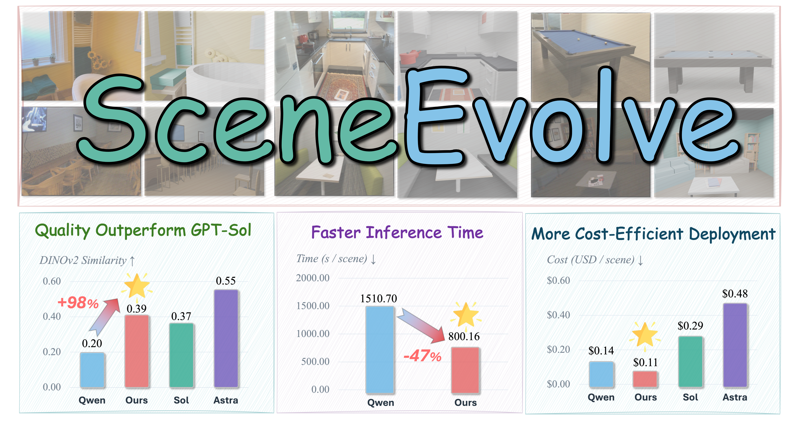

## Learning to Code the World: Harness Evolution for Compositional 3D Reconstruction

<p align="center">
  <a href="https://github.com/haoyu-agent/">Haoyu Yao</a><sup>1</sup>,
  <a href="https://chenguolin.github.io/">Chenguo Lin</a><sup>1,&dagger;</sup>,
  Ruize Du<sup>1</sup>,
  <a href="http://www.muyadong.com/">Yadong Mu</a><sup>1,&ddagger;</sup>
</p>

<p align="center">
  <sup>1</sup> Peking University &nbsp;&nbsp;
  <br>
  <sup>&dagger;</sup> Project lead &nbsp;&nbsp; <sup>&ddagger;</sup> Corresponding author
</p>

<p align="center">
  
</p>

## Installation

Requires **Python 3.11+**, **Blender**, and **Codex CLI**. Run in the following commands:

Create a virtual environment and install:

```bash
# 1) create a virtual environment and install
python -m venv .venv
source .venv/bin/activate
pip install -e .

# 2) set the API keys
export DASHSCOPE_API_KEY="your-qwen-api-key"
export OPENAI_API_KEY="your-openai-api-key"
```

Make sure `blender` and `codex` available on `PATH`, or set the path of `blender.executable` and `proposer.command` in `config.yaml`.

## Data preparation

Replace the placeholder image paths in [data/split.json](data/split.json) with absolute RGB image paths.

Each entry must contain the following fields: id, dataset, scene, group, image, and split. Use one reference image per physical scene. The group field must be unique within each dataset.

Save the completed manifest as `data/splits.json`, or update `dataset.manifest` in `config.yaml` to point to your own manifest.

## Run

```bash
# 1) check the datasets and settings.
python data.py --config config.yaml

# 2) launch an experiment for harness evolution, you can replace experiment-01 with a descriptive name for your experiment.
python sceneharness.py --config config.yaml --run-name experiment-01
```

## Evaluation

```bash
# 1) evaluate the experiment
python sceneharness.py --run-name experiment-01 --test
```

By default, each experiment runs for 30 rounds, with two proposals generated per round. Reuse the same run name to resume an existing run.

Logs are stored in `logs/`, while scene projects, rendered outputs, and execution trajectories are stored in `jobs/`.
